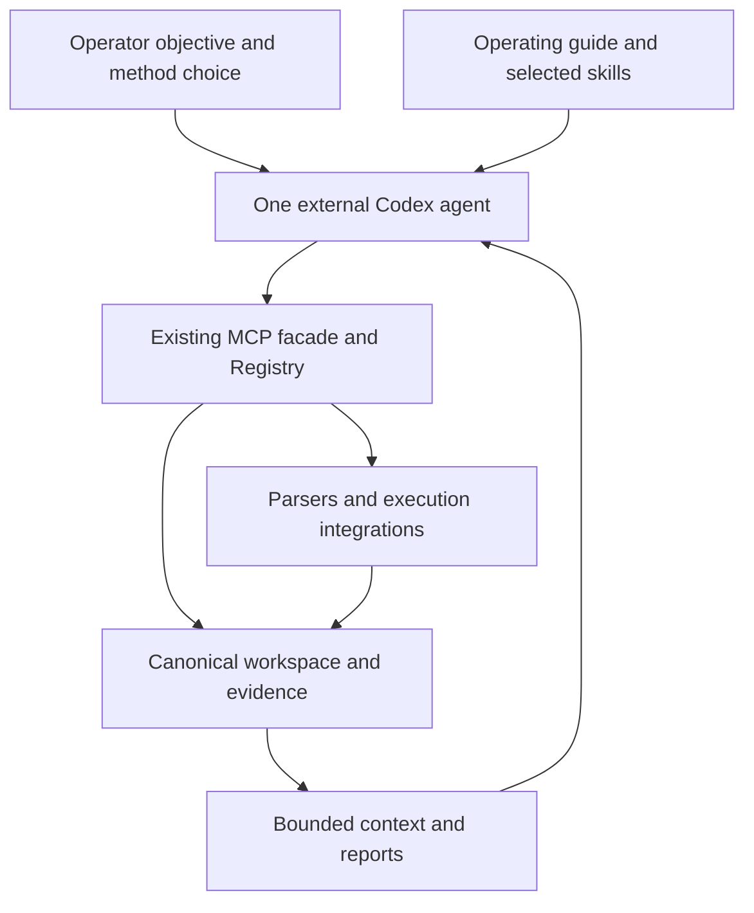

# Synapse Phase 7: selectable skills and a dependable Beta

Prepared 17 September 2026 against **Beta 8134673a386ad00eed786d3d3ba841f00fcb28de** in `K4ySuh/Synapse`. Companion review: **Synapse-Beta-Final-Review-2026-09-17.md**. This is an implementation plan; every new checkpoint starts **pending**.

## Objective

Make one external Codex agent, using the operator-selected Daybreak model, comfortable to operate through Synapse with a main web methodology and selectable vulnerability method skills. Preserve Synapse as the canonical operational layer for any supported security domain and for multiple independent consumers.

Skills should replace default heuristic interpretation and blanket candidate generation. Deterministic code should continue to own parsing, normalization, identity, evidence, persistence, execution contracts, and recovery. The model decides which method is relevant; Synapse serves the selected content and stores validated contributions.

Complete concrete Beta correctness repairs first. Then add the smallest skill/contribution extension and measure whether it improves practical operation. Do not turn this phase into another architecture modernization or a comprehensive vulnerability benchmark project.

## Existing work to preserve

- Phase 6 is implemented. Its completion ledger remains historical evidence, not a new gate to rerun at each checkpoint.
- The default connection is `modern-compact`, currently eleven operations. Standard Registry ownership is 174 actions across six packs; core-only has 42 actions.
- Canonical operating guidance is already hosted at `synapse://prompt/main` and through the `synapse-main` prompt. The hosted guidance catalog and local installer already share content.
- Three default entry skills exist: `operate-synapse`, `synapse-web-pentesting`, `synapse-cve-intelligence`. Eight multi-agent compatibility skills and one separate development skill remain available.
- `contribution.v1` already validates consumer submissions, binds authenticated context, and commits receipts with canonical state. Extend it rather than adding another submission API.
- Canonical SQLite-v2, explicit JSON-v1 migration, Action Registry dispatch, effect/lifecycle records, jobs, and existing reporting remain the architecture.
- Preserve the tested Codex compatibility negotiation. The recorded client used protocol `2025-06-18` through the modern SDK; do not require a newer protocol merely to read skill text.

## Architecture decision



No model SDK, reasoning loop, skill executor, planner, scheduler, or provider-specific behavior enters the Synapse application. Skills are versioned text resources. Retrieving a skill never runs an adapter or mutates the workspace.

### Prompt layering

| Layer | Owns | Does not own |
| --- | --- | --- |
| Package operating prompt | State recovery, contribution conventions, live schema discovery, execution/recovery rules | Detailed web methodology or a vulnerability checklist |
| `operate-synapse` | Minimal client entry and choice of Web/CVE methodology | Repeated copies of all invariants and schemas |
| `synapse-web-pentesting` | Main methodology for a web engagement, evidence-driven choice of method | Automatically running every analyzer or loading every method |
| Optional method skills | Focused analysis guidance, prerequisites, alternative explanations, evidence needed, output contract | Independent agents or their own memory |
| `synapse-cve-intelligence` | Component and vulnerability intelligence context | Mandatory participation in every web task |
| Root/nested `AGENTS.md` | Repository development rules | The engagement's runtime main prompt |

The main Web Pentesting skill functions as the web engagement's main methodology. It does not replace the small domain-neutral operating prompt. An MCP prompt/resource supplies client context; it cannot set the host's instruction hierarchy.

## Task order, models, and effort

Work serially, one checkpoint at a time. Dependencies identify prerequisites and do not request delegation. Effort describes code/contract scope, not elapsed time or reasoning-token expenditure.

| Task | Deliverable | Dependencies | Effort | Recommended model / reasoning | Checkpoints |
| --- | --- | --- | --- | --- | ---: |
| 7R0 | Accurate baseline, task ledger, and scope freeze | Reviewed Beta | Small | GPT-5.6 Sol / Medium | 1 |
| 7R1 | Candidate identity, contribution retry binding, incremental ingestion | 7R0 | Medium–Large | GPT-5.6 Sol / High | 3 |
| 7R2 | Usable context continuation and truthful provenance | 7R0 | Medium–Large | GPT-5.6 Sol / High; XHigh only for unresolved cursor consistency design | 2 |
| 7R3 | Evidence-backed method contributions using the existing data model | 7R1, 7R2 | Medium | GPT-5.6 Sol / High | 2 |
| 7R4 | Selectable hosted methods and optional local installation | 7R0 | Medium | GPT-5.6 Sol / High; Medium for packaging declarations | 2 |
| 7R5 | Main web methodology and focused vulnerability method content | 7R3, 7R4 | Medium | Daybreak Blue / High for domain content; GPT-5.6 Sol / Medium for mechanical assets | 3 |
| 7R6 | Skill-first default with retained optional heuristic helpers | 7R3–7R5 | Small–Medium | GPT-5.6 Sol / High | 2 |
| 7R7 | Distribution, bounded client comparison, and testing handoff | 7R1–7R6 | Medium | GPT-5.6 Sol / High; Daybreak Blue / High for the client exercise | 2 |

**Total: eight tasks and seventeen resumable checkpoints.** High is sufficient for ordinary implementation. Use XHigh only to settle a concrete identity, transaction, or cursor invariant, then return to High. Do not use stronger models or multiple agents merely because a task belongs to a later phase.

These model assignments are engineering recommendations, not comparative benchmark results. Sol supports Medium, High, and XHigh among its reasoning options. Daybreak access and the actual resolved model remain client/account concerns; record the available model/version without making it a server dependency. [Sol documentation](https://developers.openai.com/api/docs/models/gpt-5.6-sol), [Daybreak documentation](https://developers.openai.com/api/docs/models/gpt-daybreak-blue-latest).

## Checkpoint and resumption contract

Create `docs/modernization/phase-7-checkpoints.md`. Keep one task table plus the latest checkpoint record; older records remain available through commits. Keep `docs/modernization/phase-7-plan.md` as the repository copy of this plan and one concise `phase-7-status.md` for the current outcome and limitations. Do not add a separate handoff for every checkpoint.

At session start:

1. Read root and relevant nested `AGENTS.md`, this plan, and the latest checkpoint.
2. Inspect worktree status and the current branch. Preserve unrelated work.
3. Verify the recorded implementation commit is an ancestor of the current branch. Review relevant subsequent changes if Beta moved; do not restart already completed work.
4. Select the next incomplete checkpoint and the exact files/contracts it changes.

At checkpoint completion:

1. Finish a coherent slice and inspect its diff.
2. Run only the focused checks needed for the changed boundary.
3. Update the ledger with actual results, compatibility changes, and the next executable action.
4. Commit the coherent slice using the repository workflow. Record the code commit in a subsequent ledger update rather than trying to embed a commit's own future hash.
5. If interrupted with unfinished code, preserve it and describe the dirty files precisely. Do not call an unverified slice complete.

```yaml
task: 7R1
checkpoint: 7R1.1
status: pending # pending | in_progress | complete | blocked
review_base: 8134673a386ad00eed786d3d3ba841f00fcb28de
implementation_commit: null
branch: <actual branch>
changed_files: []
contract_changes: []
checks:
  - command: <exact focused command>
    result: <actual pass/fail, count, and relevant limitation>
known_issue: <concrete remaining issue or none>
next_checkpoint: 7R1.2
next_action: <specific module/function and next change>
dirty_worktree: <clean or exact unfinished paths>
```

Copyable task-launch instruction:

> Implement task <7R#> through its next incomplete checkpoint using phase-7-plan.md and phase-7-checkpoints.md. Confirm the actual branch and preserve existing work. Follow the relevant repository instructions. Keep the canonical Registry, workspace, evidence, and execution paths. Run the checkpoint's focused checks, record actual results and the exact next step, and commit the coherent slice. Do not spawn agents by default, restore retired phase gates, or expand into deferred features.

## 7R0 — Baseline and scope

### 7R0.1 — Record what is complete and what is being changed

1. Record the actual Beta SHA and compare it with the review base. Keep Phase 6 complete; link its existing client exercise and ledger.
2. Add the Phase 7 task table and checkpoint record. Mark all implementation checkpoints pending until current code or checks establish completion.
3. Record F1–F4 from the companion review as correctness repairs, F5 as ingestion scaling work, and F6 as a new methodology-contribution requirement.
4. Record the current counts, skill/resource identities, contribution version, and tested Codex configuration. These are compatibility baselines, not values to hardcode throughout new code.
5. State that small isolated Beta testing can begin immediately; candidate-based and larger-context results need 7R1/7R2 before they are relied upon.

Acceptance: a new session can identify the next task without reading the conversation. Documentation diff review is sufficient; no runtime suite is required.

## 7R1 — Repair mutation identity and bound ingestion work

Read `core/workspace.py`, `core/entity_merge.py`, `state/runtime.py`, `state/AGENTS.md`, and existing ingestion/contribution tests. Module paths in this plan are relative to `MCPS/Synapse-MCP/synapse_mcp/` unless stated otherwise.

### 7R1.1 — Keep curated candidates on one canonical identity

1. Fix the `curate_candidate` → compatibility write → SQLite upsert path so a new candidate receives the existing canonical identity/key before its first write.
2. Ensure a changed body, added class, refutation, or timestamp does not become a new row. Match existing canonical records and preserve their IDs, references, and review state.
3. Use an existing transactional repository mutation for the current candidate instead of persisting stale full-collection snapshots where feasible. Preserve the retained JSON-v1 behavior.
4. Define reconsideration of a refuted candidate explicitly. A rescan must not revive it automatically; a supported explicit reconsideration must not leave contradictory retired/reportable flags.
5. Add one focused lifecycle regression on SQLite-v2 and its JSON-v1 compatibility case: create → add class → refute/remove → recover after reopening the repository. Check database row identity and reportable state, not just the returned object.
6. Document possible historical duplicate candidates. Do not delete or merge existing evidence automatically. A bounded diagnostic can flag duplicate `candidateId` values for operator review.

Acceptance: one candidate identity remains throughout the lifecycle; retired candidates have no surviving reportable duplicate; a second consumer's accepted change is preserved. Do not regenerate frozen legacy fixtures to hide changed behavior.

### 7R1.2 — Bind retries to the contribution's actual target

1. In the existing receipt transaction, compare the current normalized target with the stored receipt target before returning a retry receipt.
2. Preserve uniqueness by workspace, authenticated consumer, and request ID. Same target + same envelope returns the existing receipt; same ID + a different target or payload returns a typed conflict.
3. Preserve valid receipts already stored under the current fingerprint convention. A stored target comparison is enough to address the reproduced defect without changing every historical fingerprint.
4. Add one observation-only two-target regression, plus the same-target retry control. The conflict must create no canonical entity, evidence, receipt, or revision.

Acceptance: the second target never receives the first target's success receipt. Old valid retry behavior and consumer isolation remain intact.

### 7R1.3 — Avoid full-target relation decoding for unrelated writes

1. Trace touched entities and relation sources through ingestion and collection mutations. Keep the authority-history fix from Phase 6 unchanged.
2. Limit relation synchronization to changed sources and resolvable referenced identities. Use existing indexed lookups; preserve forward-reference resolution when a previously missing destination arrives.
3. Avoid rewriting unrelated entity rows, relation rows, or revisions. Use one additive lookup index only if the actual query requires it; do not introduce a graph layer.
4. Repeat the existing review's small diagnostic at 100 and 2,000 saved endpoints, recording decoded rows or SQL work along with latency. Reuse a small diagnostic script rather than creating a benchmark framework.

Acceptance: an ordinary contribution with no relation changes does not decode all target entities. Changed relations and newly resolvable forward references remain correct. Timing is supporting evidence; no machine-specific latency threshold is required.

## 7R2 — Make compact context complete enough to use and truthful

Read `app/context.py`, `app/facade/contracts.py`, `app/facade/services.py`, `state/contracts.py`, `state/runtime.py`, and current context/modern projection tests.

### 7R2.1 — Provide real continuation without losing contradictions

1. Add an optional opaque continuation cursor to the existing `context.query` contract, with structured continuation metadata in its response. Keep the compact operation count unchanged.
2. Bind the cursor to workspace, normalized query/filter identity, section, deterministic position, and relevant revision. Keep authorization checks on each call. Do not keep a SQLite transaction or client session open to preserve a cursor.
3. Define a simple consistency rule: unchanged revision permits continuation; a conflicting revision returns an explicit refresh requirement rather than skipping records silently. Keep revision-delta queries separate from page positions.
4. Query contradictions/conflicts independently of the ordinary entity page limit. If even protected information must be bounded, expose incomplete warning coverage and its continuation; never present a false zero count.
5. Make repository ordering agree with the promised retrieval behavior. Do not suggest increasing response budget when the limiting boundary is a repository page.
6. Use one saved-data regression with more than 200 same-target, same-type entities inserted in a single revision and a contradiction beyond the old ordering cutoff. Traverse all pages, recover every identity once, and verify cursor mismatch/revision-change behavior.

Acceptance: a client can reach every matching record through bounded calls. Advancing `sinceRevision` is never advertised as a substitute for finishing a page. No graph index, search service, or new MCP operation is needed.

### 7R2.2 — Preserve knowledge state and method attribution in context

1. Preserve existing `inferred`, `observed`, `derived`, and `source` distinctions in a concise context projection, or normalize them into one documented `knowledgeState` with explicit source attribution.
2. Do not label an imported specification route or consumer-submitted assertion as runtime-observed merely because the entity table's generic lifecycle says `observed`.
3. Preserve uncertainty for historical records without enough provenance. Distinguish the fact that a statement was submitted from the claim that its contents were directly observed.
4. Retain evidence references, contrary evidence, and the contribution's method/producer identity where relevant. Coordinate with 7R3 without duplicating a provenance system.
5. Verify one imported OpenAPI route and one consumer-submitted endpoint through ingestion → context → restart. Check report projection where it uses the same knowledge labels; preserve existing report structure.

Acceptance: a fresh client can distinguish documented, inferred, reported, observed, and unknown information from the recommended context response. Keep public compatibility where possible with additive attributes; document intentional contract changes.

## 7R3 — Let skills populate the existing data model precisely

Read `core/adapters/results.py`, `_ingest_contribution_v1`, candidate identity/validation/promotion functions, action descriptions, and the contribution receipt repository. Do not add a parallel task, hypothesis, or memory database.

### 7R3.1 — Define a small typed analysis extension

1. Inventory what the initial method skills need to persist and map it to existing endpoint, observation, candidate, validation, finding, and work-item semantics.
2. Preserve `contribution.v1` envelope version `1.0` exactly. Add a backward-compatible **version 1.1** on the same modern action/source for the required analysis fields; publish both accepted versions from the application models.
3. Keep the extension narrow: stable subject/candidate identity, supported surface fields when needed, an explicit inferred/reported knowledge state, confidence/reason, supporting and contrary evidence references, and an optional method reference containing its stable ID and content digest. Use bounded typed fields rather than arbitrary metadata bags.
4. Keep generic observation values available for existing use, but do not hide the new analysis contract entirely inside free-form `value` JSON. Normalize method-produced candidates into existing canonical observations/candidates.
5. Treat method ID, digest, producer, and optional model label as attribution. Authenticated consumer identity remains server-bound. Client claims cannot certify runtime observation, execution success, or operator review.
6. Keep reviewed finding promotion and validation outcomes on the existing explicit lifecycle operations. Define how an inconclusive analysis, contrary evidence, or coverage gap is represented without inventing another status machine.

Acceptance: a skill author can identify the exact supported output and persistence route from `actions.describe`. Old 1.0 submissions retain their behavior and strict validation. No schema migration is required solely for extra typed JSON payload fields unless implementation evidence proves otherwise.

### 7R3.2 — Commit and recover the method result through canonical paths

1. Route 1.1 normalization through the existing ingestion transaction and receipt store. Reuse the repaired stable identity and evidence-linking behavior.
2. Validate referenced evidence/subjects in their existing workspace and target boundary. Preserve old evidence and reviewed dispositions when updating a candidate.
3. Return canonical IDs, receipt, and committed revision. A retry must return the same receipt; a conflicting target or payload must fail cleanly.
4. Ensure context and reports distinguish model analysis from imported facts and observed execution. Another consumer must recover the result without the original conversation or skill file being installed.
5. Add one end-to-end saved-data fixture covering a proposed hypothesis, a contrary/inconclusive conclusion, retry, and restart. Reuse existing rollback checks instead of recreating a large negative matrix.

Acceptance: a method can persist a useful, evidence-backed conclusion without a heuristic adapter, untyped sidecar, or direct database write. The canonical result remains understandable if the operating model changes.

## 7R4 — Extend existing guidance into a selectable method catalog

Read `guidance.py`, `transport/modern/server.py`, `integrations/codex.py`, `skills/README.md`, `pyproject.toml`, and the two existing skill/distribution validators.

### 7R4.1 — Use one static content manifest

1. Keep the current three entry skills and their URIs. Add optional method packages under a separate `skills/codex/web-methods/<method-id>/` directory; these are methodology packages, not agent definitions.
2. Generalize the current small hosted manifest to describe entry skills and methods. Store only stable ID, kind, description/selection trigger, source profile/path, and parent methodology where useful. Derive version, digest, and byte size from the actual packaged content.
3. Serve the method index and individual `SKILL.md`/reference documents through existing MCP resources. Reading the catalog returns metadata, not every body.
4. Keep source content shared between hosted delivery and local installation. Preserve old URIs and reject unknown paths; no remote fetching, arbitrary file serving, dynamic plugin loader, or `skills.run` operation.
5. Keep catalog contents stable for a server build/configuration. If files change while running, require an explicit restart or ensure the advertised digest and returned bytes remain consistent.

Acceptance: clients can list and retrieve selected methods, verify their versions/digests, and follow their references. Retrieval is read-only and does not dispatch anything.

### 7R4.2 — Support optional native Codex selection

1. Extend the existing asset installer with a `web-methods` profile or an equivalent small selection option. Keep the default entry profile at three skills; installing optional methods does not enable multi-agent operation.
2. Make each installed method explicitly invokable by name and clearly described for implicit selection. The hosted catalog supports clients that read resources without native skill installation.
3. Resolve shared references in both supported delivery forms. Do not assume a relative filesystem link inside a hosted document automatically becomes a readable MCP URI; provide the concrete catalog/resource mapping.
4. Update the current validators for the optional profile and source equivalence. Avoid duplicating hardcoded method lists across runtime, installer, and tests.

Acceptance: the operator can choose a method; the agent can choose one from metadata; neither requires loading all bodies or spawning another agent. Local and hosted bytes correspond to the same manifest entry.

## 7R5 — Write the main web methodology and focused method skills

Use the repository's skill-authoring guidance. This task changes methodology content; it does not create a new runtime or broaden any executable capability. Domain work is suited to Daybreak Blue High; mechanical packaging can use Sol Medium in a subsequent session.

### 7R5.1 — Refine the main web skill and prove two methods

1. Shorten duplicated bootstrap/invariant text. Keep `operate-synapse` small and make `synapse-web-pentesting` the main web methodology.
2. Add a concise method-selection index. Respect explicit operator selection; otherwise choose based on the current question and available evidence. Missing evidence produces a specific gap, not a run of every adapter.
3. Implement the first two method packages: authentication/session analysis and access-control analysis. Reuse useful existing references without making two conflicting copies.
4. Every method must state: when to load it; required context; analysis questions and alternative explanations; supporting/contrary evidence; what is still unknown; the canonical output/contribution route; and when to stop or hand back to the main web method.
5. Keep detailed procedures on demand. Do not reread unchanged guidance or action schemas within the same client context unless the server/catalog/schema version changed or the needed contract is unavailable.

Acceptance: one agent can select either method from a saved-data objective, recover context, and persist a properly attributed conclusion using 7R3. The first pilot need not run a live model to complete content/contract wiring; reserve the comparative client exercise for 7R7.

### 7R5.2 — Complete the initial method set in one consistent format

Deliver these eight bounded packages. Family grouping limits catalog noise; short family-specific references can be loaded within a package when necessary.

| Suggested stable method ID | Coverage and adapter-methodology relationship |
| --- | --- |
| `synapse-web-auth-session` | Authentication/session context; JWT, cookie, and CSRF interpretation |
| `synapse-web-access-control` | Actor/object/function/property comparisons and authorization evidence |
| `synapse-web-browser-input` | XSS and redirect interpretation from relevant browser/request context |
| `synapse-web-server-input` | SQL, command, template, and SSI input-handling hypotheses |
| `synapse-web-fetch-file-xml` | Server-side fetch, file handling, and XML boundary analysis |
| `synapse-web-structured-data` | GraphQL and serialization/deserialization context |
| `synapse-web-configuration` | Headers, CORS, cookies, TLS, and configuration evidence |
| `synapse-web-business-logic` | Workflow/state assumptions, ordering, concurrency evidence, and business rules |

1. Maintain one concise common method contract; put family knowledge in the relevant method rather than copying the entire web skill.
2. Preserve uncertainty and negative evidence. Parameter names, version strings, scanner severity, and single heuristic signals do not establish a vulnerability.
3. Reference live Synapse schemas and evidence IDs. Do not copy generated input/output schemas into skill prose or build separate local output stores.
4. Keep relevant deterministic helpers available when their output answers a specific question. Method selection does not require calling them.
5. Finish one coherent subset at a time within this checkpoint and record the completed IDs if usage runs low. Do not mark 7R5.2 complete until all eight are present and references validate.

Acceptance: all eight packages have clear selection boundaries and evidence/output requirements. No claim is made that these packages provide complete coverage of all web vulnerabilities or that more package names imply better testing.

### 7R5.3 — Keep Web/CVE transitions and resumption simple

1. Retain the existing CVE Intelligence entry skill. Carry component evidence, version uncertainty, and the actual applicability question into it, then return to the web method when appropriate.
2. Record the selected method ID/digest with accepted analysis. Use an existing work item only when the investigation genuinely needs durable ownership, dependencies, or resumption.
3. On restart, recover the canonical workspace and open question before choosing a method. No new per-agent memory, mandatory work item for every read, or autonomous subworker topology.
4. Document explicit selection examples and the shorter normal workflow. Make missing optional methods or incompatible installed versions produce a clear remedy.

Acceptance: the same agent can move among methods and CVE context without losing provenance or creating duplicate work. A second independent consumer can understand the stored result.

## 7R6 — Make heuristics optional without breaking integrations

### 7R6.1 — Publish an operation-level transition map

1. Classify existing adapter operations into deterministic parsing/extraction, heuristic interpretation, command/provider execution, and lifecycle/persistence support. Mixed modules can contain several categories.
2. Map each heuristic interpretation operation to the relevant method skill. Keep exact parsers, useful extraction, transport wrappers, job handling, and normalized output code.
3. Update default operational guidance so it does not batch-run heuristic analyzers or automatically ingest their candidates. An operator or agent can still explicitly request a useful helper for a concrete question.
4. Add concise method catalog descriptions explaining which retained helpers are optional. Keep the Action Registry authoritative for callable inputs/effects; avoid another action registry in the manifest.

Acceptance: the default agent can analyze saved evidence and contribute results without invoking a heuristic analyzer. Existing integrations continue to work when intentionally selected.

### 7R6.2 — Preserve compatibility and avoid unnecessary surface changes

1. Preserve existing action IDs, frozen legacy schemas/order, modern-direct availability, and eleven compact operations. Do not create one tool per method.
2. Keep method selection separate from capability-pack selection and authority. Disabling an entire web pack would also remove useful parsers/executors and is not the default transition mechanism.
3. Do not physically delete analyzer modules in this phase. Mark their methodology role as optional in guidance and documentation; collect usage evidence before considering later removal.
4. If a modern discovery preference is demonstrably needed after the client exercise, implement only an additive selection hint with explicit override. Do not silently make actions unreachable or rewrite legacy descriptions/fixtures merely to change ranking.
5. Clarify the adapter development guide: new integrations should supply deterministic contracts/parsers/executors as needed, while interpretation belongs in replaceable methodology content.

Acceptance: the new route is the documented default, and an explicit old helper call still follows the same Registry and state path. Rolling back the method package/profile leaves the workspace readable.

## 7R7 — Verify the deliverable and hand off Beta testing

### 7R7.1 — Validate installed behavior and fix the remaining setup polish

1. Run the focused regressions for 7R1–7R3. Preserve existing test organization; do not create another completed-phase acceptance framework.
2. Validate default, optional method, and compatibility assets. Build/install wheel and sdist once after packaging changes settle, then retrieve every selected skill and resolve its references outside the checkout.
3. Run the current core and modern suites once for the integrated release candidate because shared state/context contracts changed. Report exact results and any isolated rerun separately. Update generated modern schemas only for intentional changes; preserve frozen legacy fixtures.
4. Make the direct HTTP test report server startup errors and use a bounded readiness deadline. Do not solve the observed startup flake by adding indefinite sleeps or retrying the whole suite until green.
5. Put modern-compact first in Operations and Implementation Map; label legacy rollback separately and correct migration references. Document the minimum optional dependencies for the chosen workflow instead of implying every user needs browsers and scanner binaries.
6. Verify current-state backup/export/import with contribution receipts and the added analysis metadata using the existing bundle checks. Do not add a new migration or rollback engine.

Acceptance: repository and installed paths expose the same content and contracts. Supported older negotiation, modern-direct, legacy, and JSON-v1 behavior are accurately reported. The quick start has one clear default path.

### 7R7.2 — Run a small useful client comparison and stop expanding the phase

1. Use six saved, fictional cases: representative supported evidence, benign counterexamples, and ambiguous/insufficient evidence. Include one larger same-target inventory and one restart. No target traffic is required to validate this architectural transition.
2. Compare the previous default guidance/helper route with the new selected-method route on the same repaired runtime, available model, reasoning level, evidence, and bounded budget. This separates methodology effects from the correctness repairs. Group cases into two short matched sessions where practical, plus the required restart; do not spawn a client or worker per case. Set and record a total call/usage budget before starting, and record any unfinished comparison when that budget is reached.
3. Measure supported versus unsupported conclusions, unnecessary candidates, omissions, correct evidence attribution, MCP calls, schema/resource bytes where available, reported model usage, elapsed time, and operator corrections. Do not treat fewer calls as success if coverage or attribution worsens.
4. Record exact Codex/model/SDK/protocol/package/skill digests. Use Daybreak Blue High when provisioned. If live model access is unavailable, finish deterministic validation and mark this client checkpoint pending; do not fabricate a pass.
5. Start with one run per case/mode. Repeat only an ambiguous or failing case to resolve a concrete question. This is a practical smoke comparison, not a statistical claim of universal model superiority.
6. Publish the final Phase 7 status, known limitations, default/optional method installation, one restart example, rollback instructions, and the next Beta testing order.

Acceptance: F1–F4 no longer reproduce; F5's ordinary write path is bounded; selected methods persist useful attributed output and recover it; no material accuracy/coverage regression appears in the small cases. If the new method underperforms for a family, retain the better helper for that family and record the limitation rather than forcing a universal replacement.

Suggested subsequent testing order: fresh setup → supplied-data import → context traversal → method selection/contribution → restart/second consumer → report and bundle recovery → separately authorized real integration testing. Resolve observed failures in scoped fixes, not another open-ended modernization phase.

## Better workaround and scope boundaries

For the fastest temporary improvement, the existing Web Pentesting skill can already read selected reference documents and avoid running blanket analyzers. This can reduce workflow noise without changing the tool surface. It does **not** fix F1–F4 or supply the precise analysis contribution contract, so it is not a substitute for the first repair tasks.

The preferred full solution is the plan above: optional hosted/native method packages over retained deterministic operations. Do not replace parsers with model transcription, expose unrestricted shell execution as an adapter replacement, add another MCP server, or bake Daybreak into Synapse core. Do not start a separate safety-hardening program, restore retired phase gates, or make Claude/Hermes support a release requirement.

Ordinary MCP resources and current Codex skill loading are sufficient. The client controls which supplied guidance enters context; the server does not force activation. [MCP resources](https://modelcontextprotocol.io/specification/2026-07-28/server/resources), [Codex skill loading](https://learn.chatgpt.com/docs/build-skills).

## Definition of done

- One default agent can select a relevant web method or CVE methodology without mandatory subworkers.
- Hosted and installed method content have stable identities and matching versions/digests.
- Skills contribute through typed canonical contracts, with stable identities and supporting/contrary evidence.
- Same-target retries are idempotent; changed-target retries conflict.
- Large context can be traversed, and uncertainty/provenance survives compaction and restart.
- Heuristic analyzers are optional; useful parsers, execution integrations, and compatibility remain available.
- Existing supported suites and distribution checks have actual recorded outcomes; the bounded client checkpoint has actual evidence or an explicit pending status.
- The checkpoint ledger provides an exact next action whenever work is interrupted.
